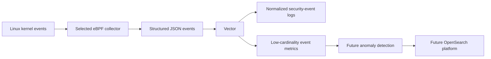

# Design: Runtime Security Telemetry Agent

## Decision

Use Tetragon as the host-level eBPF collector and focus this project on understanding eBPF events, runtime visibility, security signals, and anomaly detection.

The collector supplies broad kernel event coverage. This project owns the event schema, Vector pipeline, workload-oriented analysis, and security detections. That keeps the learning focus on interpreting and using eBPF telemetry without making a general-purpose collector implementation the central deliverable.

The collector will run once per Linux node. It will first observe the Docker Compose demo workload and later be packaged as a dedicated deployment for Kubernetes.

## Test environment

The current collector test host is a GCP Compute Engine VM provisioned by
[`terraform/`](../terraform/). It runs Ubuntu 24.04 on an `e2-micro` instance
in `us-west1-b`, with a 30 GB standard persistent disk and IAP-only SSH access.

This host was selected because its `7.0.0-1014-gcp` kernel exposes readable BTF
at `/sys/kernel/btf/vmlinux`, has `CONFIG_DEBUG_INFO_BTF=y`, and uses cgroup v2
with the memory controller enabled. Those are prerequisites for Tetragon's
CO-RE programs and for container resource attribution.

The free-tier-eligible VM has about 1 GB of RAM. Use it to prove Tetragon
startup and process-execution collection first. Resize to a billable instance
only if Tetragon, Vector, and the demo workload cannot run together reliably.
The Terraform setup documents the instance's separate ephemeral IPv4 charge and
how to stop or destroy the lab.

The Raspberry Pi 5 remains a valid Docker OOM demonstration host, but its
current Raspberry Pi OS kernel was built without BTF. It cannot run Tetragon
until it uses matching external BTF metadata or a BTF-enabled kernel.

## Collection strategy

Tetragon is the selected collector because it provides structured process, file, network, and kernel tracing events with workload-aware metadata. Its JSON and gRPC event streams preserve the underlying runtime context for Vector and later analysis. Its tracing policies can also select arbitrary kernel hook points and filter events in kernel.

Falco is deliberately out of scope for this project. Its rule-first detection engine and default security rules provide more detection behavior than is useful at this stage, when the project needs to learn from raw runtime telemetry and build its own pipeline and detections.

The project does not build a general-purpose collector in the initial scope. Small custom eBPF programs may still be used as focused learning exercises when a hook or event needs deeper investigation.

Tracee is not part of the planned collector path because the project preference is to use CNCF-aligned tools.

## Event model

The agent emits normalized runtime-security events as structured JSON. Vector receives those events, performs pipeline-level transformation and routing, and derives low-cardinality metrics.

Each event should include:

- timestamp
- event type
- host PID and TGID
- process name
- UID
- cgroup identity
- Docker or Kubernetes workload identity when available

Raw kernel events are logs. Aggregated event rates, error counts, and anomaly scores are metrics. Application traces remain a separate signal that can be correlated later.

## Event pipeline

~~~text
Selected eBPF collector
  → JSON runtime-security events
  → Vector
  → structured event output and low-cardinality metrics
~~~

Vector is the initial event-pipeline component. It keeps collection, normalization, routing, and metric derivation separate from kernel-hook code.

## Initial scope

Start with Tetragon process-execution events. This proves the complete collection path while the observed process is still alive, allowing reliable cgroup and workload attribution.

Add event sources incrementally:

1. OOM victims
2. File-access patterns
3. Additional security events chosen after the first two sources are validated

The agent reports unavailable optional event sources at startup instead of assuming every Linux kernel exposes the same hooks.

## Anomaly detection

Begin with explainable statistical methods over low-cardinality event-rate series:

1. Fixed thresholds for known-sensitive behavior
2. Rolling mean and standard deviation for rate spikes
3. EWMA for gradual shifts
4. CUSUM for persistent small changes
5. Rarity scoring for first-seen executable, destination, or capability combinations

Use workload, namespace, event type, and destination class as detector keys. Do not create per-PID or raw-path metric series.

The initial project does not include a platform-backed anomaly engine. Start with event collection and the Vector pipeline, then add statistical detection after the event schema and baseline event rates are understood.

OpenSearch is a future option for raw-event search and anomaly scoring. It is deliberately deferred because it is a full search and analytics platform that must be deployed and operated.

## Long-term target: AI agent runtime monitoring

The long-term use case is detecting unexpected data and network access by an AI agent.

Kernel events establish what the agent workload actually did: which process executed, which paths it accessed, and which network endpoints it contacted. They cannot establish the agent's task, selected tool, or the meaning of encrypted application traffic by themselves.

Pair the kernel agent with application-level agent telemetry:

1. The AI agent emits run ID, agent ID and version, tool name, task category, and trace context.
2. The kernel agent emits process, file, network, and cgroup events.
3. The pipeline correlates signals by workload identity and time. A later context bridge can map an active agent run ID to its process or cgroup.

Do not collect raw prompts, tool arguments, or file contents by default. They can contain sensitive data and are not required for the first behavior baselines.

The first AI-agent detections should combine explicit policy with statistical baselines:

1. First-seen or disallowed outbound destination for an agent workload.
2. First-seen or sensitive file-access path.
3. A tool invocation followed by a kernel action outside that tool's expected access class.
4. Sustained growth in outbound connections, bytes, or file-access events.

Network connections provide IP address and port at the kernel layer. Domain-level attribution requires a DNS signal, proxy telemetry, or application instrumentation. File-access events provide paths; sensitivity classification comes from policy or path classes, not the kernel event alone.

## Non-goals

The first versions do not enforce security policy. Kernel-level enforcement is a later decision after the event model, detection quality, and deployment permissions are understood.
