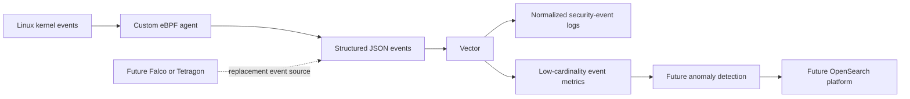

# Design: Runtime Security Telemetry Agent

## Decision

Build a custom host-level eBPF agent first.

The project goal is to learn how a runtime-security collector works end to end: kernel hooks, BPF verifier constraints, ring-buffer delivery, userspace enrichment, structured event output, and anomaly detection.

The agent will run once per Linux node. It will be packaged as a dedicated Docker image and later deployed to Kubernetes as a DaemonSet.

## Collection strategy

The custom agent is the first collector because its implementation is the main learning objective.

If the required event coverage becomes too broad or too kernel-specific, evaluate Falco or Tetragon as the long-term kernel event source. Both provide mature runtime-security capabilities while preserving the same downstream event-pipeline and anomaly-detection goals.

Tracee is not part of the planned collector path because the project preference is to use CNCF-aligned tools for a production-oriented fallback.

## Event model

The agent emits normalized runtime-security events as structured JSON. Vector receives those events, performs pipeline-level transformation and routing, and derives low-cardinality metrics.

Each event should include:

- timestamp
- event type
- host PID and TGID
- process name
- UID
- cgroup identity
- Docker or Kubernetes workload identity when available

Raw kernel events are logs. Aggregated event rates, error counts, and anomaly scores are metrics. Application traces remain a separate signal that can be correlated later.

## Event pipeline

~~~text
Custom eBPF agent
  → JSON runtime-security events
  → Vector
  → structured event output and low-cardinality metrics
~~~

Vector is the initial event-pipeline component. It keeps collection, normalization, routing, and metric derivation separate from kernel-hook code.

## Initial scope

Start with process execution events. This proves the complete collection path while the observed process is still alive, allowing reliable cgroup and workload attribution.

Add event sources incrementally:

1. OOM victims
2. File-access patterns
3. Additional security events chosen after the first two sources are validated

The agent reports unavailable optional event sources at startup instead of assuming every Linux kernel exposes the same hooks.

## Anomaly detection

Begin with explainable statistical methods over low-cardinality event-rate series:

1. Fixed thresholds for known-sensitive behavior
2. Rolling mean and standard deviation for rate spikes
3. EWMA for gradual shifts
4. CUSUM for persistent small changes
5. Rarity scoring for first-seen executable, destination, or capability combinations

Use workload, namespace, event type, and destination class as detector keys. Do not create per-PID or raw-path metric series.

The initial project does not include a platform-backed anomaly engine. Start with event collection and the Vector pipeline, then add statistical detection after the event schema and baseline event rates are understood.

OpenSearch is a future option for raw-event search and anomaly scoring. It is deliberately deferred because it is a full search and analytics platform that must be deployed and operated.

## Future collector fallback

Falco or Tetragon becomes the fallback when either condition becomes true:

1. The required event types are unavailable or too kernel-specific for the custom agent.
2. Implementing a robust event source would distract from the security analytics and anomaly-detection work.

If a fallback is used, it supplies the kernel event collection layer. This project retains ownership of event normalization, Vector integration, workload enrichment, and anomaly detection.

## Long-term target: AI agent runtime monitoring

The long-term use case is detecting unexpected data and network access by an AI agent.

Kernel events establish what the agent workload actually did: which process executed, which paths it accessed, and which network endpoints it contacted. They cannot establish the agent's task, selected tool, or the meaning of encrypted application traffic by themselves.

Pair the kernel agent with application-level agent telemetry:

1. The AI agent emits run ID, agent ID and version, tool name, task category, and trace context.
2. The kernel agent emits process, file, network, and cgroup events.
3. The pipeline correlates signals by workload identity and time. A later context bridge can map an active agent run ID to its process or cgroup.

Do not collect raw prompts, tool arguments, or file contents by default. They can contain sensitive data and are not required for the first behavior baselines.

The first AI-agent detections should combine explicit policy with statistical baselines:

1. First-seen or disallowed outbound destination for an agent workload.
2. First-seen or sensitive file-access path.
3. A tool invocation followed by a kernel action outside that tool's expected access class.
4. Sustained growth in outbound connections, bytes, or file-access events.

Network connections provide IP address and port at the kernel layer. Domain-level attribution requires a DNS signal, proxy telemetry, or application instrumentation. File-access events provide paths; sensitivity classification comes from policy or path classes, not the kernel event alone.

## Non-goals

The first versions do not enforce security policy. Kernel-level enforcement is a later decision after the event model, detection quality, and deployment permissions are understood.
